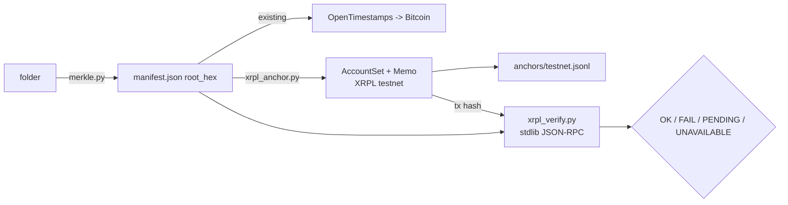
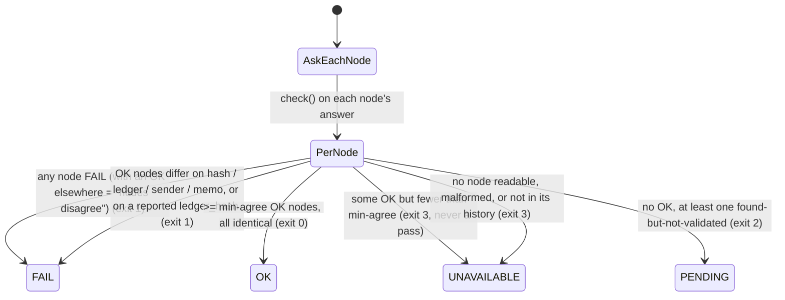

# XRPL testnet anchor — design

A second, independent anchor for a receipt's root, next to the Bitcoin one.
TESTNET ONLY. Mainnet, or selling anchoring as a service, is a founder decision.

## Office hours (compact, run inline 2026-10-30)

| Gate | Verdict | Evidence |
|---|---|---|
| Demand | UNPROVEN | No buyer has asked for XRPL. The ACP agent has 0 jobs. The demand step that ships with this build is a post to XRPL builders, which asks a question instead of pitching. It's staged locally for the founder and is not in this repo. |
| Who | XRPL builders, and later tokenization teams | Hypothesis only. |
| Impact | Confirms in seconds and costs a fraction of a cent, against Bitcoin's 1.3–128 h | Measured Bitcoin lag (memory 09-30). XRPL figures checked on the live testnet tx in `anchors/`. |
| 10-star | One receipt checkable on two unrelated chains with one stdlib command | `xrpl_verify.py` + `verify.py folder` |
| 10x | Not for speed alone (OpenTimestamps calendars already answer in seconds). The gain is a second, independent ledger. | — |

**OFFICE HOURS VERDICT: BUILD (small, testnet, reversible).** It's cheap enough to build as the demand probe itself. Don't go further than testnet without an outside signal.

## Data flow

## The memo (wire format v0)

- `MemoType` = hex(`orphograph.com/xrpl-anchor/v0`)
- `MemoFormat` = hex(`application/json`)
- `MemoData` = hex(canonical JSON `{"alg":…,"receipt_id":…,"root_hex":…,"v":0}`), with sorted keys and no spaces

The transaction is an `AccountSet` carrying no flags. XRPL rejects an XRP payment to yourself (`temREDUNDANT`), and an `AccountSet` is a no-op that still pays the fee and lands in a validated ledger.

## Verification state machine / error map

**Trust boundary.** Everything a node returns is untrusted. A single lying node could fabricate the whole transaction, so OK needs `--min-agree` distinct hosts (default 2; a repeated host is one vote) from different operators: Ripple's `s.altnet` and XRPL Labs' `testnet.xrpl-labs.com`. Ripple's `clio.altnet` would not add independence. Node answers are type-checked and capped at 2 MB, so a hostile shape becomes a verdict, never a traceback. The verifier sends an honest, named User-Agent, because one node's CDN returns 403 to urllib's default agent.

**History and durability.** XRPL Labs keeps about 2 h of ledger history. To verify an older anchor, pass full-history nodes with `--node` (it replaces the defaults; `--min-agree` cannot exceed the node count), or accept a labelled SINGLE-NODE result with `--min-agree 1`. Otherwise the result is honestly UNAVAILABLE. Each node must return the exact transaction hash that was requested. A malformed answer counts as unavailable, not as dissent. The anchor tool reads back once, with no retry loop (if the second node lags, the anchor is logged UNAVAILABLE and can be re-verified later), and logs every submitted anchor whatever the verdict. Node use rules (identity, blocks, traffic) are in NODES.md. Testnet is reset from time to time, so a testnet anchor is a demo, not a durable record.

What OK proves: the root existed no later than the ledger's close time. It doesn't prove who made the folder. Anyone can write any memo from any account, so `--account` only binds the anchor to Orphograph's address. Without `--account` the result says the anchor is unbound.

Diagrams left out: user flow (a CLI with one command per side), dependency graph (anchor needs xrpl-py 5.2.0 pinned, verify needs only the stdlib), and decision tree (the state machine above covers it).
