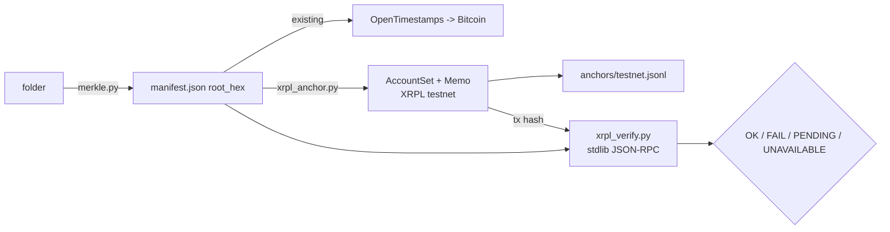
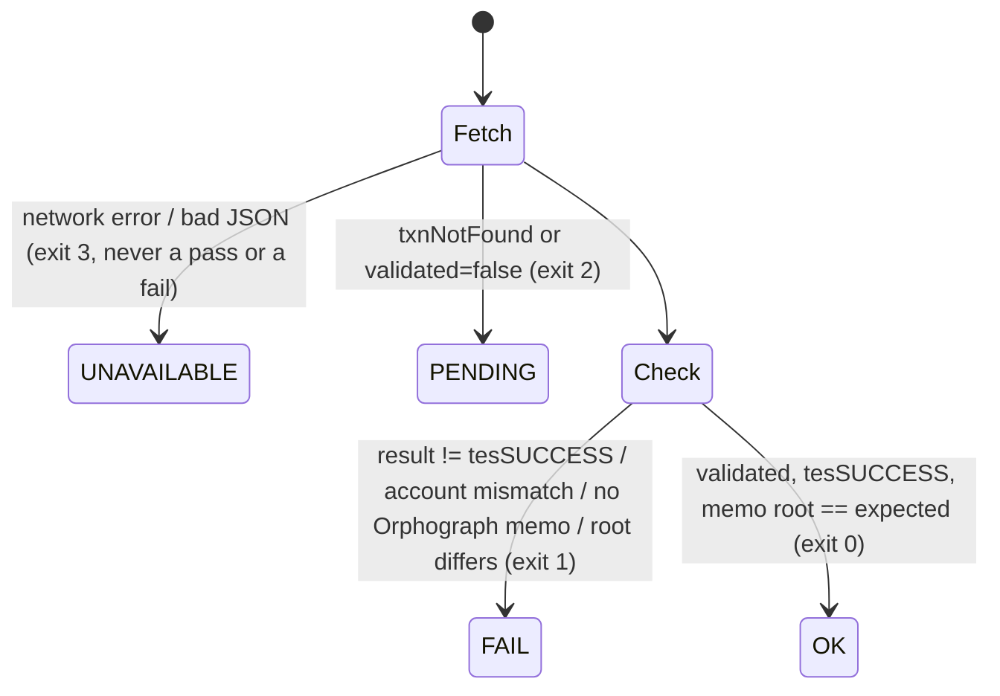

# XRPL testnet anchor — design

A second, independent anchor for a receipt's root, next to the Bitcoin one.
TESTNET ONLY. Mainnet, or selling anchoring as a service, is a founder decision.

## Office hours (compact, run inline 2026-10-30)

| Gate | Verdict | Evidence |
|---|---|---|
| Demand | UNPROVEN | No buyer has asked for XRPL. The ACP agent has 0 jobs. The demand step that ships with this build is a post to XRPL builders, which asks a question instead of pitching. It's staged locally for the founder and is not in this repo. |
| Who | XRPL builders, and later tokenization teams | Hypothesis only. |
| Impact | Confirms in seconds and costs a fraction of a cent, against Bitcoin's 1.3–128 h | Measured Bitcoin lag (memory 09-30). XRPL figures checked on the live testnet tx in `anchors/`. |
| 10-star | One receipt checkable on two unrelated chains with one stdlib command | `xrpl_verify.py` + `verify.py folder` |
| 10x | Not for speed alone (OpenTimestamps calendars already answer in seconds). The gain is a second, independent ledger. | — |

**OFFICE HOURS VERDICT: BUILD (small, testnet, reversible).** It's cheap enough to build as the demand probe itself. Don't go further than testnet without an outside signal.

## Data flow

## The memo (wire format v0)

- `MemoType` = hex(`orphograph.com/xrpl-anchor/v0`)
- `MemoFormat` = hex(`application/json`)
- `MemoData` = hex(canonical JSON `{"alg":…,"receipt_id":…,"root_hex":…,"v":0}`), with sorted keys and no spaces

The transaction is an `AccountSet` carrying no flags. XRPL rejects an XRP payment to yourself (`temREDUNDANT`), and an `AccountSet` is a no-op that still pays the fee and lands in a validated ledger.

## Verification state machine / error map

What OK proves: the root existed no later than the ledger's close time. It doesn't prove who made the folder. Anyone can write any memo from any account, so `--account` only binds the anchor to Orphograph's address. Without `--account` the result says the anchor is unbound.

Diagrams left out: user flow (a CLI with one command per side), dependency graph (anchor needs xrpl-py 5.2.0 pinned, verify needs only the stdlib), and decision tree (the state machine above covers it).
